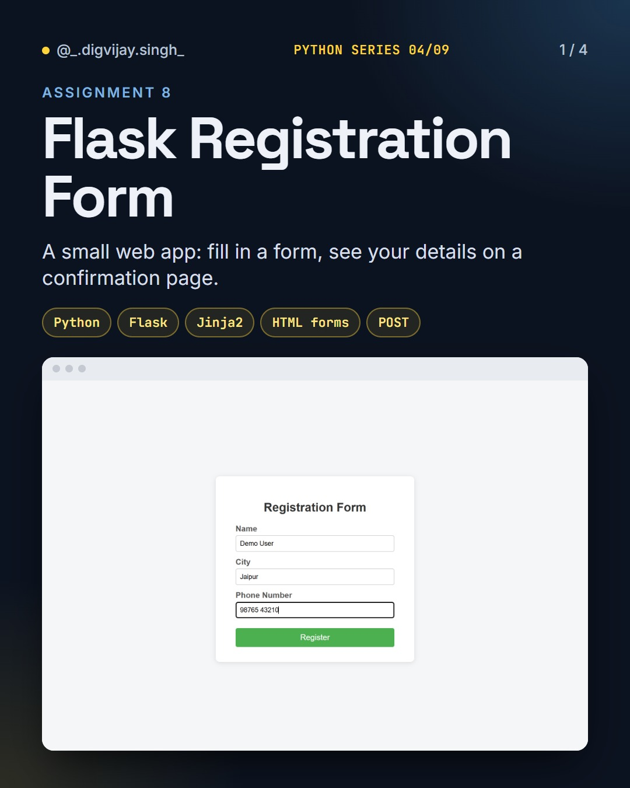
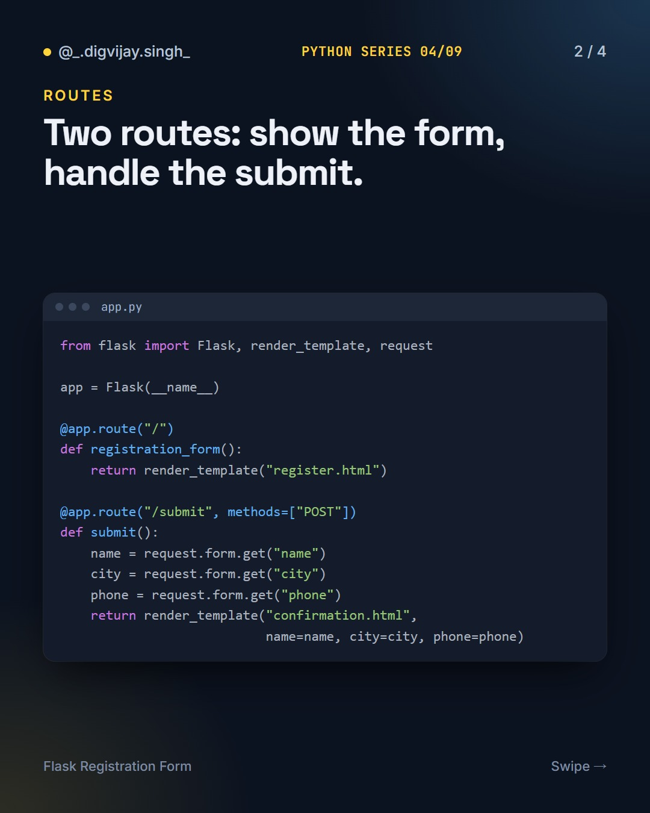
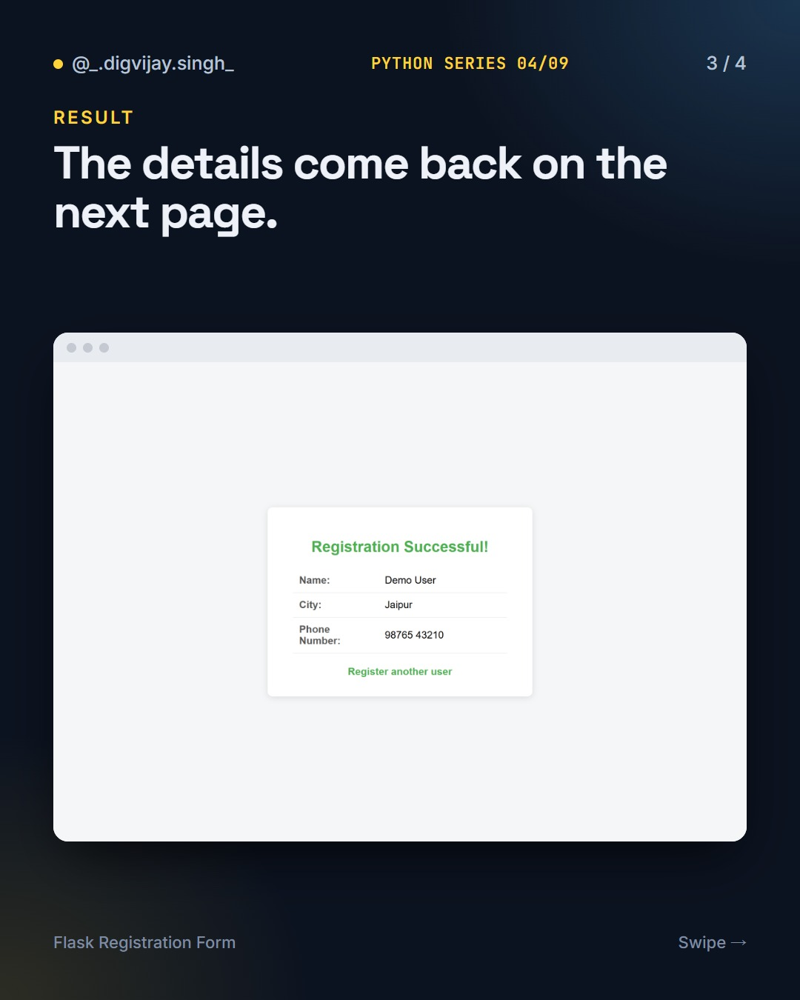
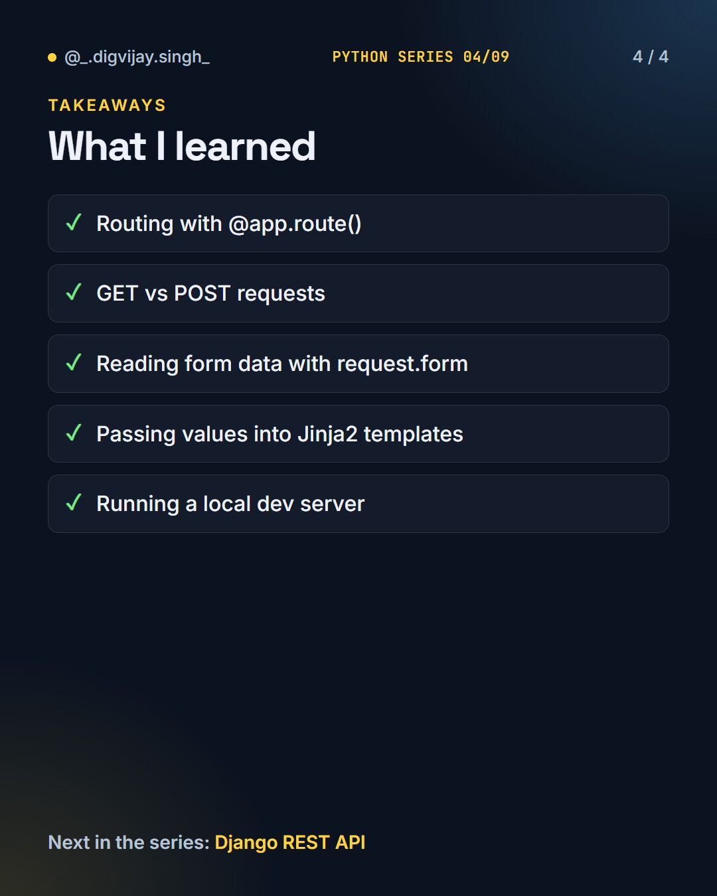

# Flask Registration Form

<p align="center"></p>

A small Flask web app: fill in a registration form and see your details on a confirmation page.

Part 4 of 9 in my **Python Series**.

## How to run

```bash
pip install -r requirements.txt
python app.py
```

Then open http://127.0.0.1:5000.

## What I learned

- Routing with `@app.route()`
- GET vs POST requests
- Reading form data with `request.form`
- Passing values into Jinja2 templates
- Running a local dev server

## Slides

<p>



</p>

## The Python Series

1. [Python Basics](https://github.com/digvijay165/python-basics)
2. [Tkinter Calculator](https://github.com/digvijay165/tkinter-calculator)
3. [Python + PostgreSQL](https://github.com/digvijay165/python-postgresql)
4. **Flask Registration Form**
5. [Django REST Blog API](https://github.com/digvijay165/django-rest-blog-api)
6. [Python Web Scraper](https://github.com/digvijay165/python-web-scraper)
7. [OpenCV Practicals](https://github.com/digvijay165/opencv-practicals)
8. [Selenium Automation](https://github.com/digvijay165/selenium-automation)
9. [Python Chat App](https://github.com/digvijay165/python-chat-app)
